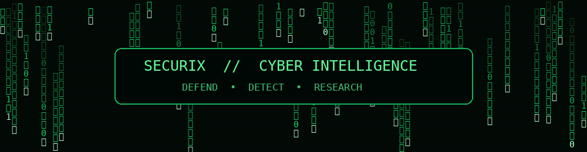
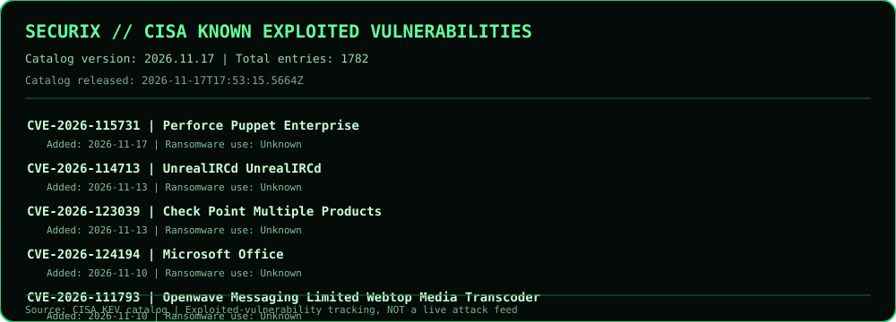

# `SECURIX CYBER SOLUTIONS`

### `CYBERSECURITY • THREAT INTELLIGENCE • DIGITAL FORENSICS`

**Defend. Detect. Investigate. Research.**

---

## `> SYSTEM_OVERVIEW`

SECURIX focuses on cybersecurity research, ethical security assessment, cyber threat intelligence, OSINT research, and digital forensics.

- **Security research:** vulnerability analysis, secure configuration, and defensive engineering.
- **Threat intelligence:** public advisories, exploited-vulnerability tracking, and evidence-based analysis.
- **Digital forensics:** structured evidence handling, timeline analysis, and reproducible reporting.
- **Security automation:** Python-based workflows, data processing, and defensive tooling.

> All research and demonstrations are conducted in controlled environments and within defined authorization and legal boundaries.

## `> LIVE_THREAT_INTELLIGENCE`

### CISA Known Exploited Vulnerabilities (automatically refreshed)

The panel below is generated from the **official CISA Known Exploited Vulnerabilities (KEV) catalog**. KEV tracks vulnerabilities that have evidence of exploitation in the wild. It is **not** a real-time map of live cyberattacks.

  

**Live public threat and Internet activity dashboards**  
These external dashboards provide their own current visualizations. GitHub profile READMEs do not run embedded interactive dashboards, so the links open the live sources.

| Source | What it provides |
|---|---|
| [Cloudflare Radar](https://radar.cloudflare.com/) | Global Internet traffic, attacks, and technology trends |
| [Check Point Live Cyber Threat Map](https://threatmap.checkpoint.com/) | Public cyber threat activity visualization |
| [Fortinet Threat Map](https://threatmap.fortiguard.com/) | FortiGuard threat activity visualization |
| [CISA KEV Catalog](https://www.cisa.gov/known-exploited-vulnerabilities-catalog) | Official catalog of known exploited vulnerabilities |
| [CISA Cybersecurity Advisories](https://www.cisa.gov/news-events/cybersecurity-advisories) | Official security advisories |

External dashboards are operated by their respective providers. Their coverage, update frequency, definitions, and availability may differ.

## `> TECH_STACK`

  

**Areas of interest:** Network Security · Web Security · Vulnerability Research · OSINT · Threat Intelligence · Incident Response · Digital Forensics · Security Automation

## `> SELECTED_WORK`

Pin your strongest repositories here. Replace the placeholders with real repository links and descriptions.

| Repository | Description |
|---|---|
| [`REPOSITORY_NAME_1`](https://github.com/YOUR_GITHUB_USERNAME/REPOSITORY_NAME_1) | Describe a completed security or research project |
| [`REPOSITORY_NAME_2`](https://github.com/YOUR_GITHUB_USERNAME/REPOSITORY_NAME_2) | Describe a defensive tool or automation project |
| [`REPOSITORY_NAME_3`](https://github.com/YOUR_GITHUB_USERNAME/REPOSITORY_NAME_3) | Describe a forensic or threat-intelligence project |

## `> GITHUB_ACTIVITY`

Statistics images are provided by third-party services and may be rate-limited or temporarily unavailable. They are not security telemetry.

## `> CONNECT`

- GitHub: [@YOUR_GITHUB_USERNAME](https://github.com/YOUR_GITHUB_USERNAME)
- Website: `ADD_OFFICIAL_WEBSITE`
- LinkedIn: `ADD_LINKEDIN_PROFILE`

---

`SECURIX // CYBER INTELLIGENCE`

Evidence-led research. Responsible disclosure. Defensive security.

